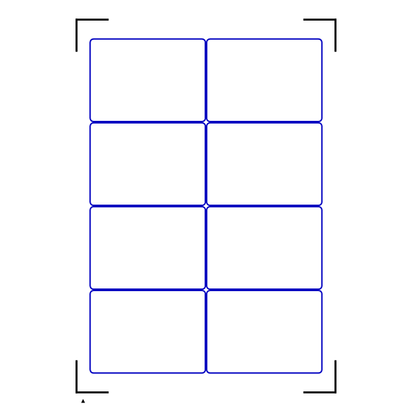

# Siser Print & Cut Guide

Use MTGProxyPrinter to print the artwork and registration marks, and export its
matching SVG cutting contours. Leonardo prepares and sends the cutting job.
**Print the artwork PDF directly. Do not regenerate the artwork through Leonardo.**

The workflows below succeeded on Bigntazt's Juliet with Leonardo 1.1.31. Their visual
results do not guarantee numerical physical accuracy or compatibility with every
printer, cutter, layout or material.

## Before exporting

1. Finalize the document's paper, orientation, margins, spacing, bleed and occupied
   slots. Select **Siser Page Marks (experimental)** in the document settings.
   Supported document sheets are Letter portrait and A4 landscape, including
   custom sheets with the same dimensions.
2. Export the ordinary artwork PDF and **Export current page cut template (SVG)…**
   without changing the layout between them. The SVG captures only the selected
   page; export a matching SVG for each page you intend to cut. It contains rounded
   regular-card contours and square oversized contours, without registration marks.
3. Print the artwork PDF using the established **actual size / 100%** procedure,
   without fit-to-page scaling. The **calibration PDF** is a separate outline/ruler
   sheet, not the artwork PDF for this workflow.
4. For the documented A4 route, keep MTGProxyPrinter in landscape and the PDF
   landscape compatibility workaround **disabled**. Output rotations and local
   printer corrections affect the whole page; the SVG retains nominal coordinates.

Siser export does not compact the document or alter its arrangement. If you want
to compact it, use the separate operation before exporting both files.

## Tested Letter portrait route

Bigntazt reported successful cuts of all nine cards, with visually identical
alignment on every card. Row spacing, column spacing and bleed were each **1 mm**.
Artwork overlap with registration marks was intentional and did not prevent that
successful result.

- Use the matching Letter portrait artwork PDF and nine-card SVG from the same
  finalized layout. Print the PDF directly at actual size / 100%.
- Import the matching SVG into the Letter portrait Leonardo setup with
  **Artwork Only**. Use the matching contour placement established for that layout;
  do not resize the paths or substitute placement values from older diagnostic
  probes. No undocumented numeric placement entries are supplied by this guide.
- Use **Print & Cut / Page Marks**, set the imported guides to cut lines, and use
  the matching printed sheet for the cutting job.

The saved setup is specific to its layout. This nine-card result does not establish
placement for other occupancies or every layout using Letter paper.

## Tested A4 landscape artwork / portrait-fed Juliet route

Bigntazt reported that the A4 landscape artwork print cut successfully after
reorienting its SVG on an A4 portrait Leonardo sheet. All cards appeared
symmetrical and alignment was visually perfect, by operator observation.

Keep the MTGProxyPrinter document and artwork PDF **A4 landscape**. Use the
matching complete **4-column, 2-row** SVG, and print the PDF directly at actual
size / 100%, with the PDF landscape workaround disabled.

The clarified sequence that succeeded was:

1. Create an **A4 portrait** sheet in Leonardo **before importing**.
2. Drag and drop our exported **A4 landscape SVG**.
3. Choose **Artwork Only**.
4. Retain the **default import position**.
5. Rotate the **complete guide group counterclockwise by one quarter-turn (90°)**
   into the portrait cutting arrangement. Do not separately translate or resize it.
   The 4-column, 2-row landscape arrangement becomes **2 columns and 4 rows of
   sideways cards** for portrait feed.
6. Set the imported SVG guides to **cut lines**.
7. Match the physical printed sheet to the portrait cutting preview and proceed
   with the cut.

No duplicate print/cut group or numeric relocation is required for this documented
A4 route. Earlier diagnostic workflows used different steps.

*PREVIEW extracted from “A4 - 4x2 - Template - Baseline.lds”: eight rounded
contours, corner marks and a small lower-left triangle. The triangle is a visible
orientation cue in this saved preview; it is not claimed to be present in our
PDFs, nor to have established camera semantics. The preview does not prove exact
native dimensions, cut settings, rotation direction or import history. Those
operational details above are operator-reported.*

## Scope and troubleshooting

- Default import placement succeeded for the tested complete A4 4×2 grid. Other
  occupancies and asymmetric layouts are not established by that trial.
- A saved LDS belongs to its layout. Changed spacing, bleed, card size or occupied
  slots requires a matching new export and setup; do not reuse an old cut template
  after changing the printed arrangement.
- Operational cutting settings may follow Leonardo's **last-used values**, rather
  than restore from the LDS. Check the active settings; this guide does not supply
  unreported tool, pressure, speed or pass values.
- Recalibrating the cutter resolved the earlier large baseline displacement
  **without application compensation**. No offset, scale or skew correction from
  that observation is built into the Siser profile.
- Overlap is not automatically blocked or repaired. Keep marks visible and
  unobstructed for reliable registration. The successful crowded Letter trial is
  not a universal optical-clearance qualification.
- Normal page and printer clipping remain. The application does not move or shrink
  the design to protect marks or avoid clipping.
- This Siser reorientation procedure is **not a Silhouette procedure**. Romeo
  physical equivalence remains unverified.
- Borderless mode is **untested and deferred**, not required or prohibited by this
  guide. Automatic SVG rotation and calculated placement controls are deferred.
- The reported missing-card-list incident recovered after restarting. No database
  cause or fix was identified; this is not advice to delete data.

Earlier A4 investigations established software/reference geometry, not an earlier
physical two-pass workflow. Letter was the earlier established physical baseline;
the A4 portrait-feed result recorded here is the later successful physical trial.

Development of this feature was AI-assisted, with focused automated tests and
operator-reported physical print/cut testing.
